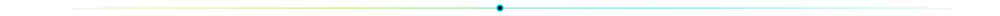

## Hi, I'm Jed Padro

<samp>Building ideas into practical technology.</samp>

Computer Engineering student at Southern Leyte State University, Philippines. 
I learn best by building, from embedded firmware to web and desktop apps, 
and every project leaves me with something new I want to understand.

<picture>
  <source media="(prefers-color-scheme: light)" srcset="./assets/accent-light.svg" />
  
</picture>

### Tech Stack

<table>
  <tr>
    <td valign="top"><b>LANGUAGES</b> </td>
    <td valign="top"><b>FRAMEWORKS &amp; DATABASES</b>  </td>
  </tr>
  <tr>
    <td valign="top"><b>EMBEDDED SYSTEMS</b>  </td>
    <td valign="top"><b>TOOLS &amp; PLATFORMS</b> </td>
  </tr>
</table>

### Projects

<picture>
  <source media="(prefers-color-scheme: light)" srcset="./assets/divider-light.svg" />
  
</picture>

### Currently Exploring

| Software Engineering | AI / ML | Data Engineering |
| :-- | :-- | :-- |
| Testing, code review, and code that stays readable as it grows | Starting from the fundamentals of how models learn | Pipelines, data modeling, and moving data between systems |

### GitHub Stats

<picture>
  <source media="(prefers-color-scheme: light)" srcset="https://github-stats-extended.vercel.app/api?username=jeedp&show_icons=true&hide_rank=true&hide=issues%2Ccontribs&hide_border=true&border_radius=10&custom_title=GitHub%20stats&bg_color=F8FAFC&title_color=0E7490&text_color=0F172A&icon_color=0E7490" />
  
</picture>
<picture>
  <source media="(prefers-color-scheme: light)" srcset="https://github-stats-extended.vercel.app/api/top-langs/?username=jeedp&layout=compact&langs_count=6&hide_border=true&border_radius=10&custom_title=Most-used%20languages&bg_color=F8FAFC&title_color=0E7490&text_color=0F172A" />
  
</picture>

<picture>
  <source media="(prefers-color-scheme: light)" srcset="./assets/divider-light.svg" />
  
</picture>

### Connect

