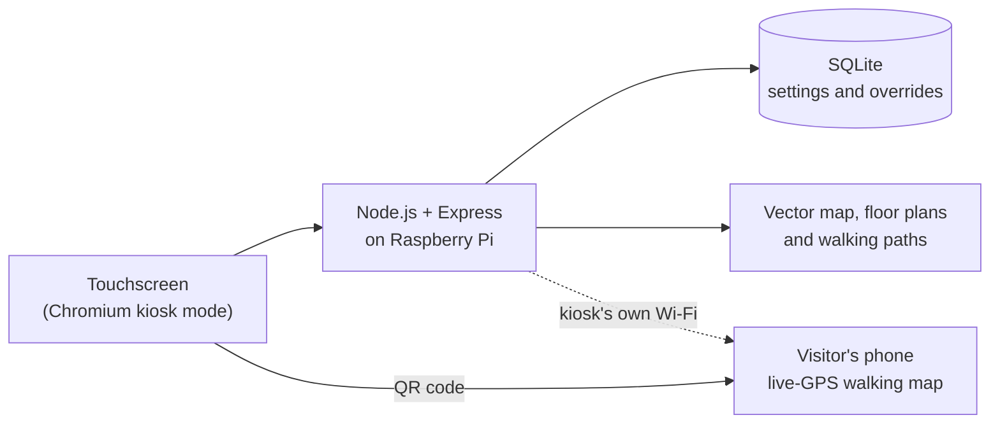
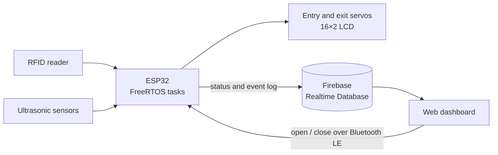

<picture>
  <source media="(prefers-color-scheme: light)" srcset="./assets/annual-cover-light.svg" />
  
</picture>

**Jed B. Padro** · BS Computer Engineering, Southern Leyte State University  
Computer Engineering student building practical systems across software and hardware.

[jedpadro@gmail.com](mailto:jedpadro@gmail.com) · [LinkedIn](https://www.linkedin.com/in/jed-padro-ba9563299/) · [Portfolio](https://jeedp.github.io/portfolio/) · [Repositories](https://github.com/jeedp?tab=repositories)

**Summary.** I'm a 4th-year Computer Engineering student in the Philippines working toward a career in software engineering. My projects tend to sit where software meets hardware: firmware on an ESP32, a server on a Raspberry Pi, and the interface people actually use.

**Outlook.** Completing my thesis, the SLSU Campus Wayfinding System, then looking for a software engineering internship.

#### Highlights

- Reduced the thesis kiosk's floor drawings from 14 MB to 1.5–3 MB per floor so the campus map runs smoothly on a Raspberry Pi 4.
- Built the Smart Parking Gate end to end: ESP32 firmware, RFID and ultrasonic sensing, a live Firebase dashboard, and gate control from the browser over Bluetooth.
- Split the parking gate's firmware into FreeRTOS tasks on separate ESP32 cores, keeping gate control apart from network updates.
- Wrote the deployment script and setup guide that turn a blank Raspberry Pi card into a working kiosk.

#### Key figures

<picture>
  <source media="(prefers-color-scheme: light)" srcset="./assets/annual-figures-light.svg" />
  
</picture>

Notes to the figures

- **Period:** the twelve months to 18 November 2026, as GitHub counts public contributions (commits, pull requests, issues and reviews). Figures are a snapshot taken on that date and are not updated automatically.
- **Contributions** include work in repositories owned by others, such as the thesis repository.
- **Languages** are measured only across repositories I own, so they lean toward my earlier C# projects and leave out the JavaScript thesis work.

Layout based on the Annual Report template from [README Templates](https://github.com/Dr-At0mic/README-Templates). Motion stops if your system asks for reduced motion.

#### Portfolio

**[SLSU Campus Wayfinding System](https://github.com/cymrcsm/slsu-map-navigation)** · Thesis · team of two · in progress  
An offline touchscreen kiosk that helps students and visitors find buildings, offices, and facilities on the SLSU main campus, with a 2D vector map, floor plans, and walking directions.

- **My part:** performance on the Raspberry Pi (floor drawings cut from 14 MB to 1.5–3 MB each), the QR hand-off that continues a route on a visitor's phone with live GPS, and the setup script and guide for deploying the kiosk.
- **Stack:** JavaScript, Node.js, Express, SQLite, HTML/CSS, Raspberry Pi

How it works

- **Runs without internet.** The map, floor plans, and routes are served from the Pi itself, so the kiosk keeps working if the campus network drops.
- **Phones get the route two ways:** over the kiosk's own Wi-Fi network, or from a public copy of the map for phones on mobile data.
- **Live GPS needs HTTPS,** so the kiosk serves the phone page over a trusted certificate rather than plain HTTP.

The repository is hosted on [@cymrcsm](https://github.com/cymrcsm)'s account.

**[Smart Parking Gate System](https://github.com/jeedp/Smart-Parking-Gate-System)** · IoT · solo  
A parking gate that admits RFID card holders, tracks free slots with ultrasonic sensors, and reports both to a live web dashboard.

- **My part:** all of it, from pin mapping and firmware to the dashboard, including unit tests for the gate and RFID logic.
- **Stack:** C++, ESP32, FreeRTOS, PlatformIO, Firebase, Bluetooth LE, JavaScript

How it works

- **Gate control and network updates run as separate tasks on separate cores,** so a slow connection to Firebase does not hold up the gate.
- **Manual control goes straight to the ESP32 over Bluetooth,** so an operator can open or close the gate from the browser without the internet.
- **The dashboard only reads from Firebase:** live slot count, gate state, and the last 20 events.

**[TrainSMART](https://github.com/jeedp/TrainSMARTApp)** · Desktop · solo  
A desktop application for workout templates, exercise management, workout tracking, and body measurements.

- **My part:** the full application, including user accounts with input validation and a relational data model written in T-SQL.
- **Stack:** C#, Windows Forms, .NET Framework, SQL Server

#### Capabilities

| Area | Technologies |
| :-- | :-- |
| Languages |  |
| Web |  |
| Databases |   |
| Embedded |   |
| Tools |   |

#### Development

- **Software engineering practices** — testing, code review, and maintainable architecture.
- **Data engineering** — storage, pipelines, and how data moves between systems.
- **Systems development** — designing hardware and software as one system.
- **AI and machine learning** — not started yet; the next area I plan to study.

<picture>
  <source media="(prefers-color-scheme: light)" srcset="./assets/annual-closing-light.svg" />
  
</picture>
