<picture>
  <source media="(prefers-color-scheme: light)" srcset="./assets/hero-light.svg" />
  
</picture>

  <a href="mailto:jedpadro@gmail.com"><code>✉&nbsp;jedpadro@gmail.com</code></a>&nbsp;
  <a href="https://www.linkedin.com/in/jed-padro-ba9563299/"><code>in/jed-padro</code></a>&nbsp;
  <a href="https://github.com/jeedp?tab=repositories"><code>⌥&nbsp;repositories</code></a>

I'm **Jed Padro**, a 4th-year Computer Engineering student at Southern Leyte State University, developing toward a career in **software engineering and emerging technologies**. My degree taught me how machines work from the circuit up; my projects are where I learn to write software people can rely on.

> <samp>now&nbsp;&nbsp;&nbsp;&nbsp;&nbsp;&nbsp;&nbsp;&nbsp;&nbsp;&nbsp;&nbsp;&nbsp;</samp> finishing my thesis, the SLSU Campus Wayfinding System 
> <samp>learning&nbsp;&nbsp;&nbsp;&nbsp;&nbsp;&nbsp;&nbsp;</samp> software engineering practices, data engineering, systems development 
> <samp>curious&nbsp;about&nbsp;&nbsp;</samp> AI and machine learning — not started yet, next on my list 
> <samp>looking&nbsp;for&nbsp;&nbsp;&nbsp;&nbsp;</samp> a software engineering internship

### <samp>01 — selected work</samp>

<picture>
  <source media="(prefers-color-scheme: light)" srcset="./assets/cover-wayfinding-light.svg" />
  
</picture>

**[SLSU Campus Wayfinding System](https://github.com/cymrcsm/slsu-map-navigation)** — a touchscreen kiosk that helps students and visitors find any building, office, or facility on campus. It runs fully offline on a Raspberry Pi, with a custom 2D vector map, office search, floor plans, and walking directions.

<samp>what I worked on</samp>

 

- **Making it run well on a Pi** — shrank and re-encoded the floor drawings (14 MB → 1.5–3 MB per floor) and lightened map zooming so it stays smooth on a Raspberry Pi 4
- **Phone hand-off** — scan a QR code at the kiosk and the route continues on your phone as a live-GPS walking map
- **Deployment** — one re-runnable script that turns a fresh Raspberry Pi OS card into the kiosk, including its own Wi-Fi network, plus the setup guide the team works from
- **Kiosk details** — an on-screen keyboard, walking time and distance on each route, and an idle screensaver that resets the kiosk for the next visitor

Built with a teammate; the repository is hosted on [@cymrcsm](https://github.com/cymrcsm)'s account.

<samp>JavaScript · Node.js · Express · SQLite · HTML/CSS · Raspberry Pi</samp>

 

<picture>
  <source media="(prefers-color-scheme: light)" srcset="./assets/cover-parking-light.svg" />
  
</picture>

**[Smart Parking Gate System](https://github.com/jeedp/Smart-Parking-Gate-System)** — a parking gate that knows who is allowed in and how many slots are left, and reports both to a live web dashboard. The project where I worked on every layer, from pin mapping to the browser.

<samp>what I built</samp>

 

- **Firmware** — ESP32 code split into modules for the gate, RFID reader, ultrasonic sensors, buzzer, and display, with gate control, sensing, and dashboard updates running as separate FreeRTOS tasks
- **Gate control** — RFID cards open the entry gate; servos drive entry and exit, with a 16×2 LCD showing status at the gate
- **Dashboard** — real-time slot availability over Firebase, with manual gate control from the browser and a Bluetooth fallback
- **Tests** — unit tests for the gate and RFID logic alongside the firmware

<samp>C++ · ESP32 · FreeRTOS · PlatformIO · Bluetooth LE · Firebase · JavaScript</samp>

 

<picture>
  <source media="(prefers-color-scheme: light)" srcset="./assets/cover-trainsmart-light.svg" />
  
</picture>

**[TrainSMART](https://github.com/jeedp/TrainSMARTApp)** — a desktop app for planning workouts and tracking progress over time. An earlier project, and the one that taught me to structure an application around its database.

<samp>what I built</samp>

 

- Workout templates and exercise management
- Workout tracking and body measurements
- User accounts with login and input validation
- Relational data model written in T-SQL on SQL Server

<samp>C# · Windows Forms · .NET Framework · SQL Server</samp>

 

<samp>also built</samp>

 

- **Task Manager** — a task tracking web app in Laravel, with database migrations, seeders, and Blade views (private repository)
- **[LoginSystem](https://github.com/jeedp/LoginSystem)** and **[Calculator](https://github.com/jeedp/Calculator)** — early C# Windows Forms projects where I learned UI and database basics

### <samp>02 — toolbox</samp>

  <samp>languages&nbsp;&nbsp;&nbsp;</samp>
  

  <samp>web&nbsp;&nbsp;&nbsp;&nbsp;&nbsp;&nbsp;&nbsp;&nbsp;&nbsp;</samp>
  

  <samp>databases&nbsp;&nbsp;&nbsp;</samp>
  &nbsp;
  

  <samp>embedded&nbsp;&nbsp;&nbsp;&nbsp;</samp>
  &nbsp;
  

  <samp>tools&nbsp;&nbsp;&nbsp;&nbsp;&nbsp;&nbsp;&nbsp;</samp>
  &nbsp;
  

### <samp>03 — how I work</samp>

- **I build the whole path.** Sensor, firmware, database, dashboard — I'd rather understand every layer than hand one off as a black box.
- **I design for the hardware I actually have.** When our campus map stuttered on a Raspberry Pi, I cut each floor drawing from 14 MB to under 3 MB instead of asking for a faster board.
- **I write things down.** Setup scripts, deployment guides, and acceptance checklists, so a teammate can rebuild the system from a blank SD card without me in the room.
- **I test before the hardware arrives.** Smoke tests and laptop tooling first, so the day the device shows up is for integration, not surprises.

### <samp>04 — currently learning</samp>

- **Software engineering practices** — testing, pull-request workflows, and architecture that stays readable as a project grows
- **Data engineering** — what happens to data after it is collected: storage, pipelines, and structure
- **Systems development** — designing hardware and software as one system rather than two halves joined at the end
- **AI / machine learning** — not started yet. It's the field I'm most curious about, and I plan to begin with the fundamentals.

<samp>github activity</samp>

 

These cards only count repositories I own. My thesis work lives in a teammate's repository, so it isn't reflected here.

  <samp>open to internships and collaborations</samp>  
  <a href="mailto:jedpadro@gmail.com"><code>✉&nbsp;jedpadro@gmail.com</code></a>&nbsp;
  <a href="https://www.linkedin.com/in/jed-padro-ba9563299/"><code>in/jed-padro</code></a>

<!-- TODO: add a portfolio link above once the site is live -->
