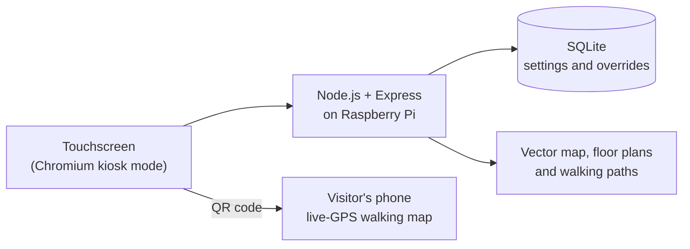
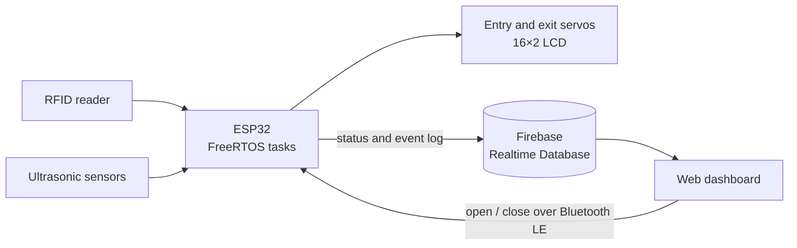

<picture>
  <source media="(prefers-color-scheme: light)" srcset="./assets/header-light.svg" />
  
</picture>

  
  
  

## About

I'm Jed Padro, a 4th-year Computer Engineering student at Southern Leyte State University in the Philippines, working toward a career in software engineering.

Most of what I build sits where software meets hardware: firmware on an ESP32, a server on a Raspberry Pi, and the interface people actually use. I care about systems that keep working outside the lab, and I document them well enough that someone else can run them.

## Featured projects

### [SLSU Campus Wayfinding System](https://github.com/cymrcsm/slsu-map-navigation)

THESIS · TEAM OF TWO · IN PROGRESS

An offline touchscreen kiosk that helps students and visitors find buildings, offices, and facilities on the SLSU main campus, with a 2D vector map, floor plans, and walking directions.

- Cut the floor drawings from 14 MB to 1.5–3 MB each so the map runs smoothly on a Raspberry Pi 4
- Built the QR hand-off that continues a route on a visitor's phone with live GPS
- Wrote the setup script and guide that turn a blank Raspberry Pi card into a working kiosk

<samp>JavaScript · Node.js · Express · SQLite · HTML/CSS · Raspberry Pi</samp>

How it works

The map, floor plans, and routes are served from the Pi itself, so the kiosk keeps working without internet. Phones get the route over the kiosk's own Wi-Fi, or from a public copy of the map when they are on mobile data. The repository is hosted on [@cymrcsm](https://github.com/cymrcsm)'s account.

### [Smart Parking Gate System](https://github.com/jeedp/Smart-Parking-Gate-System)

IOT · SOLO

A parking gate that admits RFID card holders, tracks free slots with ultrasonic sensors, and reports both to a live web dashboard.

- Wrote the ESP32 firmware as FreeRTOS tasks on separate cores, so network updates never hold up the gate
- Built the dashboard: live slot count and event log from Firebase, and gate control from the browser over Bluetooth
- Added unit tests for the gate and RFID logic

<samp>C++ · ESP32 · FreeRTOS · PlatformIO · Firebase · Bluetooth LE · JavaScript</samp>

How it works

### [TrainSMART](https://github.com/jeedp/TrainSMARTApp)

DESKTOP · SOLO

A desktop application for workout templates, exercise management, workout tracking, and body measurements, with user accounts and a relational data model on SQL Server.

<samp>C# · Windows Forms · .NET Framework · SQL Server</samp>

Also built

- [**Portfolio site**](https://jeedp.github.io/portfolio/) — a responsive personal site in plain HTML, CSS, and JavaScript, with light and dark modes
- **Task Manager** — a task tracking web app in Laravel (private repository)
- [**LoginSystem**](https://github.com/jeedp/LoginSystem) and [**Calculator**](https://github.com/jeedp/Calculator) — early C# Windows Forms projects

## Tech stack

  <samp>languages&nbsp;&nbsp;</samp>
  

  <samp>web&nbsp;&nbsp;&nbsp;&nbsp;&nbsp;&nbsp;&nbsp;&nbsp;</samp>
  

  <samp>databases&nbsp;&nbsp;</samp>
  &nbsp;

  <samp>embedded&nbsp;&nbsp;&nbsp;</samp>
  &nbsp;

  <samp>tools&nbsp;&nbsp;&nbsp;&nbsp;&nbsp;&nbsp;</samp>
  &nbsp;

## GitHub activity

<picture>
  <source media="(prefers-color-scheme: light)" srcset="https://github-stats-extended.vercel.app/api?username=jeedp&show_icons=true&hide_rank=true&hide=issues%2Ccontribs&hide_border=true&border_radius=12&custom_title=GitHub%20activity&bg_color=FBF9F7&title_color=1B1416&text_color=1B1416&icon_color=8B1E2D" />
  
</picture>
<picture>
  <source media="(prefers-color-scheme: light)" srcset="https://github-stats-extended.vercel.app/api/top-langs/?username=jeedp&layout=compact&langs_count=6&hide_border=true&border_radius=12&custom_title=Most-used%20languages&bg_color=FBF9F7&title_color=1B1416&text_color=1B1416" />
  
</picture>

<picture>
  <source media="(prefers-color-scheme: light)" srcset="https://streak-stats.demolab.com?user=jeedp&hide_border=true&border_radius=12&background=FBF9F7&ring=8B1E2D&fire=8B1E2D&currStreakLabel=8B1E2D&sideLabels=1B1416&currStreakNum=1B1416&sideNums=1B1416&dates=6A5F61&stroke=E6DEDA" />
  
</picture>

Live cards from [GitHub Stats Extended](https://github.com/stats-organization/github-stats-extended) and [GitHub Readme Streak Stats](https://github.com/DenverCoder1/github-readme-streak-stats). Languages count only repositories I own, so my JavaScript thesis work, hosted on a teammate's account, does not appear.

## Currently learning

- **Software engineering practices** — testing, code review, and maintainable architecture
- **Data engineering** — storage, pipelines, and how data moves between systems
- **Systems development** — designing hardware and software as one system
- **AI and machine learning** — not started yet; the next area I plan to study

## Connect

Open to software engineering internships and collaborations.

[jedpadro@gmail.com](mailto:jedpadro@gmail.com) · [LinkedIn](https://www.linkedin.com/in/jed-padro-ba9563299/) · [Portfolio](https://jeedp.github.io/portfolio/) · [GitHub](https://github.com/jeedp)
