<picture>
  <source media="(prefers-color-scheme: light)" srcset="./assets/hero-light.svg" />
  
</picture>

&nbsp;

Most of what I know, I learned by picking a real problem, 
then figuring out the hardware and software it takes to solve it.

It's led me from desktop software to microcontrollers and single-board computers, 
and next it's pulling me toward AI/ML and data engineering.

&nbsp;

&nbsp;

<picture>
  <source media="(prefers-color-scheme: light)" srcset="./assets/accent-light.svg" />
  
</picture>

### 🛠️ Tech Stack

<table>
  <tr>
    <td valign="top"><b>LANGUAGES</b> </td>
    <td valign="top"><b>FRAMEWORKS &amp; DATABASES</b>  </td>
  </tr>
  <tr>
    <td valign="top"><b>EMBEDDED SYSTEMS</b>  </td>
    <td valign="top"><b>TOOLS &amp; PLATFORMS</b> </td>
  </tr>
</table>

 

### 🔭 Currently Exploring

- Software Engineering
- AI / ML
- Data Engineering

 

### 📊 Stats

<picture>
  <source media="(prefers-color-scheme: light)" srcset="https://github-stats-extended.vercel.app/api?username=jeedp&show_icons=true&hide_rank=false&hide_title=true&include_all_commits=true&v=2&hide_border=true&border_radius=10&bg_color=FFFFFF&text_color=17181C&icon_color=D95F00&ring_color=D95F00" />
  
</picture>

<picture>
  <source media="(prefers-color-scheme: light)" srcset="https://streak-stats.demolab.com?user=jeedp&hide_border=true&border_radius=10&background=FFFFFF&ring=D95F00&fire=D95F00&currStreakLabel=D95F00&sideLabels=17181C&currStreakNum=121317&sideNums=17181C&dates=666C78&stroke=D9D4CB" />
  
</picture>

 

<!--
### 🤝 Connect
-->

  

