<div align="center">



<a href="https://github.com/jeedp">
  
</a>

<br />

<a href="https://www.linkedin.com/in/jed-padro-ba9563299/"></a>
<a href="mailto:jedpadro@gmail.com"></a>
<a href="https://github.com/jeedp?tab=repositories"></a>

</div>

<br />

I'm a Computer Engineering student developing toward a career in **software engineering and emerging technologies**. My degree taught me how machines work from the circuit up; my projects are where I learn to write software that people can rely on — and AI, data, and connected devices are where I'm taking that next.

| | |
| --- | --- |
| 🔨 **Now** | Finishing the [SLSU Campus Wayfinding System](https://github.com/cymrcsm/slsu-map-navigation), my thesis project |
| 🌱 **Learning** | Machine learning fundamentals, testing, and data pipelines |
| 🎯 **Looking for** | A software engineering internship, and people to build practical systems with |

##  About

I'm in my 4th year of **BS Computer Engineering** at **Southern Leyte State University (SLSU)**, Philippines. I like the part of a project where it has to work somewhere real: on a Raspberry Pi behind a touchscreen, on an ESP32 at a parking gate, on a campus where the signal drops.

**How I work**

- 🔌 **I build the whole path.** Sensor, firmware, database, dashboard — I'd rather understand every layer than hand one off as a black box.
- ⚙️ **I design for the hardware I actually have.** When our campus map stuttered on a Raspberry Pi, I cut each floor drawing from 14 MB to under 3 MB instead of asking for a faster board.
- 📋 **I write things down.** Setup scripts, deployment guides, and acceptance checklists, so a teammate can rebuild the system from a blank SD card without me in the room.
- 🧪 **I test before the hardware arrives.** Smoke tests and laptop tooling first, so the day the device shows up is for integration, not surprises.
- 🤖 **I've had a first taste of machine learning, and I want more.** I trained flood prediction models for a data science challenge and I use AI coding tools daily; now I'm learning the fundamentals properly.

##  Featured Projects

| Project | What it is | Area | My role |
| --- | --- | --- | --- |
| 🧭 [**SLSU Campus Wayfinding**](https://github.com/cymrcsm/slsu-map-navigation) | Offline touchscreen kiosk that guides people around campus | Web · Raspberry Pi | Thesis, team of two |
| 🌧️ [**Jeepney Rerouting**](https://github.com/Nick-Miras/JeepneyRerouting) | Flood prediction and route rerouting for Metro Manila | Machine learning · Data | Team entry, PJDSC 2024 |
| 🚗 [**Smart Parking Gate**](https://github.com/jeedp/Smart-Parking-Gate-System) | RFID parking gate with a live web dashboard | IoT · Embedded | Solo, every layer |
| 🏋️ [**TrainSMART**](https://github.com/jeedp/TrainSMARTApp) | Desktop app for planning and tracking workouts | Desktop · Database | Solo |

<details open>
<summary><b>🧭 SLSU Campus Wayfinding System</b> — thesis, in progress</summary>

<br />

A touchscreen kiosk that helps students and visitors find any building, office, or facility on the SLSU main campus. It runs fully offline on a Raspberry Pi, with a custom 2D vector map, office search, floor plans, and walking directions.

**What I worked on**

- **Making it run well on a Pi** — shrank and re-encoded the floor drawings (14 MB → 1.5–3 MB per floor) and lightened map zooming so it stays smooth on a Raspberry Pi 4
- **Phone hand-off** — scan a QR code at the kiosk and the route continues on your phone as a live-GPS walking map
- **Deployment** — one re-runnable script that turns a fresh Raspberry Pi OS card into the kiosk, including its own Wi-Fi network, plus the setup guide the team works from
- **Kiosk details** — an on-screen keyboard, walking time and distance on each route, and an idle screensaver that resets the kiosk for the next visitor

<sub>Built with a teammate; the repository is hosted on <a href="https://github.com/cymrcsm">@cymrcsm</a>'s account.</sub>


</details>

<details>
<summary><b>🌧️ Jeepney Rerouting</b> — data science, PJDSC 2024</summary>

<br />

A flood prediction and jeepney rerouting system for Metro Manila, built as our team's entry to the Philippine Junior Data Science Challenge 2024. It predicts which parts of the road network will flood, then finds alternative routes so jeepneys can keep running.

**What I worked on**

- **Flood prediction** — a spatial Random Forest model trained on rainfall, elevation, and flood hazard data
- **Road network** — processing OpenStreetMap data for Metro Manila into a graph, then optimising and parallelising the route search
- **Uncertainty** — Monte Carlo simulations of how flooding disrupts the network, and kriging to interpolate rainfall between measurement points
- **Data collection** — Python scripts that download and prepare NASA precipitation data

<sub>Built with a teammate; the repository is hosted on <a href="https://github.com/Nick-Miras">@Nick-Miras</a>'s account.</sub>


</details>

<details>
<summary><b>🚗 Smart Parking Gate System</b> — IoT, solo</summary>

<br />

A parking gate that knows who is allowed in and how many slots are left, and reports both to a live web dashboard. This is the project where I worked on every layer, from pin mapping to the browser.

```text
 sensor  ──▶  firmware  ──▶  database  ──▶  dashboard
 RFID         ESP32          Firebase       web app
```

- **Firmware** — ESP32 code split into modules for the gate, RFID reader, ultrasonic sensors, buzzer, and display, with gate control, sensing, and dashboard updates running as separate FreeRTOS tasks
- **Gate control** — RFID cards open the entry gate; servos drive entry and exit, with a 16×2 LCD showing status at the gate
- **Dashboard** — real-time slot availability over Firebase, with manual gate control from the browser and a Bluetooth fallback
- **Tests** — unit tests for the gate and RFID logic alongside the firmware


</details>

<details>
<summary><b>🏋️ TrainSMART</b> — desktop app, solo</summary>

<br />

A desktop app for planning workouts and tracking progress over time. An earlier project, and the one that taught me to structure an application around its database.

- Workout templates and exercise management
- Workout tracking and body measurements
- User accounts with login and input validation
- Relational data model written in T-SQL on SQL Server


</details>

<details>
<summary><b>Also built</b></summary>

<br />

- **Task Manager** — a task tracking web app in Laravel, with database migrations, seeders, and Blade views <sub>(private repository)</sub>
- **[LoginSystem](https://github.com/jeedp/LoginSystem)** and **[Calculator](https://github.com/jeedp/Calculator)** — early C# Windows Forms projects where I learned UI and database basics

</details>

##  Tech Stack

<table>
  <tr>
    <td valign="top" width="170"><b>Languages</b></td>
    <td>
      
    </td>
  </tr>
  <tr>
    <td valign="top"><b>Web</b></td>
    <td>
      
    </td>
  </tr>
  <tr>
    <td valign="top"><b>Databases</b></td>
    <td>
      
      <br />
      
    </td>
  </tr>
  <tr>
    <td valign="top"><b>Embedded</b></td>
    <td>
      
      <br />
      
    </td>
  </tr>
  <tr>
    <td valign="top"><b>Tools</b></td>
    <td>
      
      <br />
      
    </td>
  </tr>
</table>

##  Where I'm Headed

The goal is a career in software engineering. These are the areas I'm growing into, and where each one stands today.

| Direction | Where I am now | What I'm learning next |
| --- | --- | --- |
| **Software Engineering** | Shipping full applications: desktop, web, and server | Testing, pull-request workflows, and architecture that stays readable as a project grows |
| **AI / Machine Learning** | Trained a spatial Random Forest for flood prediction in a team data science entry; using AI coding tools daily | The fundamentals underneath those models, and where a model belongs in a real system |
| **Data Engineering** | Collected and prepared satellite rainfall and map data in Python; designed schemas and real-time databases for my apps | Building proper pipelines: how data is stored, moved, and kept reliable at scale |
| **Embedded Systems & IoT** | Building ESP32 and Raspberry Pi systems end to end | Designing hardware and software as one system rather than two halves joined at the end |

##  Connect

<a href="https://www.linkedin.com/in/jed-padro-ba9563299/"></a>
<a href="mailto:jedpadro@gmail.com"></a>
<!-- TODO: add a Portfolio badge here once the portfolio site is live -->

<details>
<summary><b>GitHub activity</b></summary>

<br />

<div align="center">


<sub>Much of my recent work lives in teammates' repositories, so these numbers undercount it.</sub>

</div>

</details>

<br />

<div align="center">
  <sub>Built in Southern Leyte, Philippines · one sensor reading at a time</sub>
</div>
